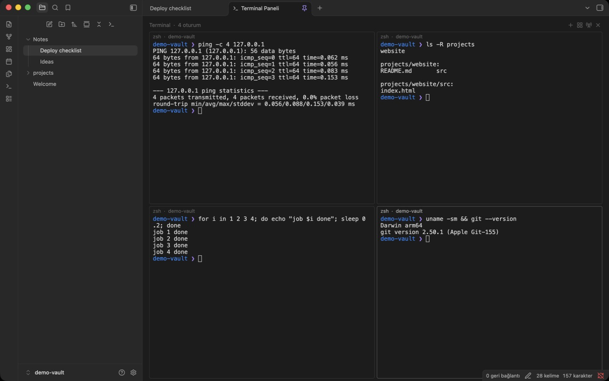

# ecu-terminal

A standalone terminal for Obsidian desktop on macOS, built on xterm.js and node-pty.
No other plugins required.




## Features

- **Docked terminal** at the bottom or right of the workspace. `Cmd+J` shows or hides it,
  `Cmd+Shift+J` moves it. Hiding does not kill the shell.
- **Terminal Panel**: a full-size pinned tab used only as a terminal screen. Open it by
  right-clicking the terminal icon in the file explorer's toolbar, or from the command palette.
- **Split grid** (MobaXterm style): `Cmd+D` adds a terminal. Auto grid, side-by-side or stacked
  layouts. Drag the gutters to resize, double-click a gutter to equalize. `Option+Cmd+Arrow`
  moves between panes.
- **MultiExec**: type into all panes at once.
- **Close one, close others, close all**. Asks first if a command is still running.
- **Long-command notifications**: when a command runs longer than a set time, you get a notice,
  or a macOS notification if Obsidian is not focused. Exact for local zsh (shell integration via
  OSC 133), prompt-based heuristic inside SSH sessions.
- **Capture to note**: insert the last command and its output, or the current selection, into
  the active note as a formatted block.
- **Open terminal here** from the file menu (folders and files) and the editor menu. New
  terminals start in the vault folder, the note's folder or a custom directory.
- `Cmd+F` search, `Cmd+K` clear, copy on select, clickable links.
- The session buffer is kept across restarts.
- Colors follow the active Obsidian theme.
- Settings tab: position and size, shell, start folder, font, cursor, scrollback, notifications,
  Option as Meta, and more.

## Install

macOS only (Apple Silicon and Intel). node-pty ships as prebuilt N-API binaries for
`darwin-arm64` and `darwin-x64`, so there is no build step.

1. Download or clone this repository into `<your vault>/.obsidian/plugins/ecu-terminal`:

   ```sh
   cd "<your vault>/.obsidian/plugins"
   git clone https://github.com/erencanucarr/ecu-terminal.git
   ```

   The folder must contain `main.js`, `styles.css`, `manifest.json` and `vendor/`.
2. In Obsidian, open **Settings > Community plugins**, turn off Restricted mode if needed,
   and enable **ecu-terminal**.
3. Press `Cmd+J`.

If macOS blocks the native module after a download, clear the quarantine flag:

```sh
xattr -dr com.apple.quarantine "<your vault>/.obsidian/plugins/ecu-terminal"
```

## Keyboard shortcuts

| Shortcut | Action |
| --- | --- |
| `Cmd+J` | Show / hide the docked terminal |
| `Cmd+Shift+J` | Move the docked terminal (bottom / right) |
| `Cmd+D` | New terminal in the grid (inside a terminal) |
| `Option+Cmd+Arrow` | Move focus to the neighboring pane |
| `Cmd+F` | Search in the terminal |
| `Cmd+K` | Clear the terminal |
| `Ctrl+D` / `exit` | Close the current terminal |

Every action is also available in the command palette and in the terminal's right-click menu.
The `Cmd+J` / `Cmd+Shift+J` hotkeys can be changed under **Settings > Hotkeys**.

## Language

The user interface (menus, notices, settings) is in Turkish.

## License

MIT, see [LICENSE](LICENSE). Bundled third-party code in `vendor/`:
[xterm.js](https://github.com/xtermjs/xterm.js) and
[node-pty](https://github.com/microsoft/node-pty), both MIT, with their license files included.
