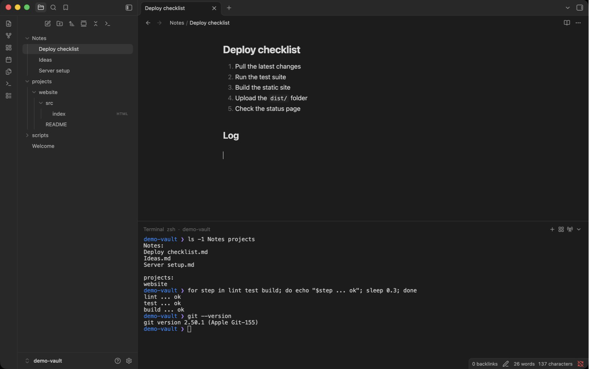

# ecu-terminal

A standalone terminal for Obsidian desktop on macOS, Windows and Linux, built on xterm.js
and node-pty. No other plugins required.




## Features

- **Docked terminal** at the bottom or right of the workspace. `Cmd/Ctrl+J` shows or hides it,
  `Cmd/Ctrl+Shift+J` moves it. Hiding does not kill the shell.
- **Terminal Panel**: a full-size pinned tab used only as a terminal screen. Open it by
  right-clicking the terminal icon in the file explorer's toolbar, or from the command palette.
- **Split grid** (MobaXterm style): add terminals to a grid. Auto grid, side-by-side or stacked
  layouts. Drag the gutters to resize, double-click a gutter to equalize.
- **MultiExec**: type into all panes at once.
- **Close one, close others, close all**. Asks first if a command is still running.
- **Long-command notifications**: when a command runs longer than a set time, you get a notice,
  or a system notification if Obsidian is not focused. Exact for zsh, bash and PowerShell
  (shell integration via OSC 133), prompt-based heuristic for other shells and inside SSH.
- **Capture to note**: insert the last command and its output, or the current selection, into
  the active note as a formatted block.
- **Open terminal here** from the file menu (folders and files) and the editor menu. New
  terminals start in the vault folder, the note's folder or a custom directory.
- Search, clear, copy on select, clickable links.
- The session buffer is kept across restarts.
- Colors follow the active Obsidian theme.
- Settings tab: position and size, shell, start folder, font, cursor, scrollback, notifications,
  and more.

## Platforms

| OS | Architectures | Default shell | Status |
| --- | --- | --- | --- |
| macOS | Apple Silicon, Intel | `$SHELL` (zsh) | Tested |
| Windows 10 1809+ / 11 | x64, arm64 | PowerShell 7 if installed, else Windows PowerShell | Not tested yet |
| Linux | x64 (glibc 2.28+), arm64 (glibc 2.34+) | `$SHELL` (usually bash) | Not tested yet |

node-pty ships as prebuilt N-API binaries for all of these, so there is no build step and
Obsidian updates don't need a rebuild. Any other shell can be set in the settings.
If you run Windows or Linux, issue reports are very welcome.

On Linux, the Flatpak and Snap builds of Obsidian run in a sandbox, so the terminal sees the
sandbox, not your full system. The AppImage or .deb build behaves like a normal terminal.

## Install

1. Download or clone this repository into `<your vault>/.obsidian/plugins/ecu-terminal`:

   ```sh
   cd "<your vault>/.obsidian/plugins"
   git clone https://github.com/erencanucarr/ecu-terminal.git
   ```

   The folder must contain `main.js`, `styles.css`, `manifest.json` and `vendor/`.
2. In Obsidian, open **Settings > Community plugins**, turn off Restricted mode if needed,
   and enable **ecu-terminal**.
3. Press `Cmd+J` (macOS) or `Ctrl+J` (Windows, Linux).

If macOS blocks the native module after a download, clear the quarantine flag:

```sh
xattr -dr com.apple.quarantine "<your vault>/.obsidian/plugins/ecu-terminal"
```

## Keyboard shortcuts

On Windows and Linux, plain `Ctrl` keys inside a terminal go to the shell (`Ctrl+C`, `Ctrl+R`,
`Ctrl+W`…), so the terminal's own shortcuts use `Ctrl+Shift`.

| macOS | Windows / Linux | Action |
| --- | --- | --- |
| `Cmd+J` | `Ctrl+J` | Show / hide the docked terminal |
| `Cmd+Shift+J` | `Ctrl+Shift+J` | Move the docked terminal (bottom / right) |
| `Cmd+D` | `Ctrl+Shift+D` | New terminal in the grid |
| `Option+Cmd+Arrow` | `Alt+Arrow` | Move focus to the neighboring pane |
| `Cmd+C` / `Cmd+V` | `Ctrl+Shift+C` / `Ctrl+Shift+V` | Copy / paste (on Windows also `Ctrl+V`, and `Ctrl+C` with a selection) |
| `Cmd+F` | `Ctrl+Shift+F` | Search in the terminal |
| `Cmd+K` | `Ctrl+Shift+K` | Clear the terminal |
| `Cmd+P` | `Ctrl+Shift+P` | Command palette while a terminal has focus |
| `Ctrl+D` / `exit` | `Ctrl+D` / `exit` | Close the current terminal |

Every action is also available in the command palette and in the terminal's right-click menu.
The show/hide and move hotkeys can be changed under **Settings > Hotkeys**.

## Language

The user interface (menus, notices, settings) is in Turkish.

## License

MIT, see [LICENSE](LICENSE). Bundled third-party code in `vendor/`, all MIT, with license files
included: [xterm.js](https://github.com/xtermjs/xterm.js) and
[node-pty](https://github.com/microsoft/node-pty) 1.1.0. The Linux node-pty binaries come from
[@lydell/node-pty](https://github.com/lydell/node-pty), prebuilt from the same node-pty release.
